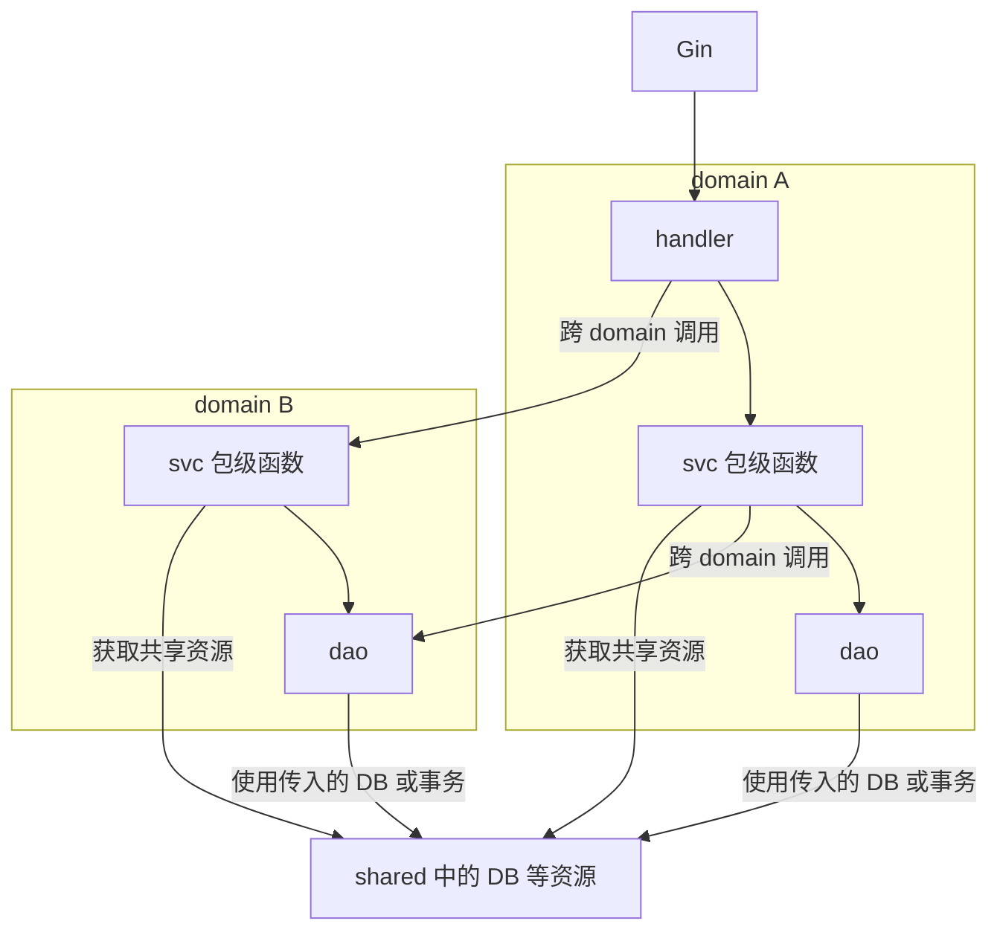
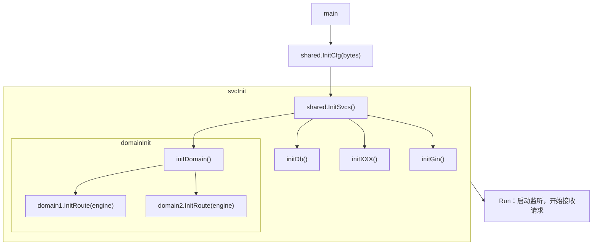
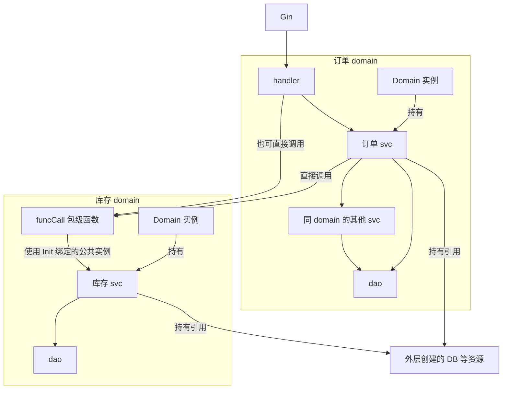
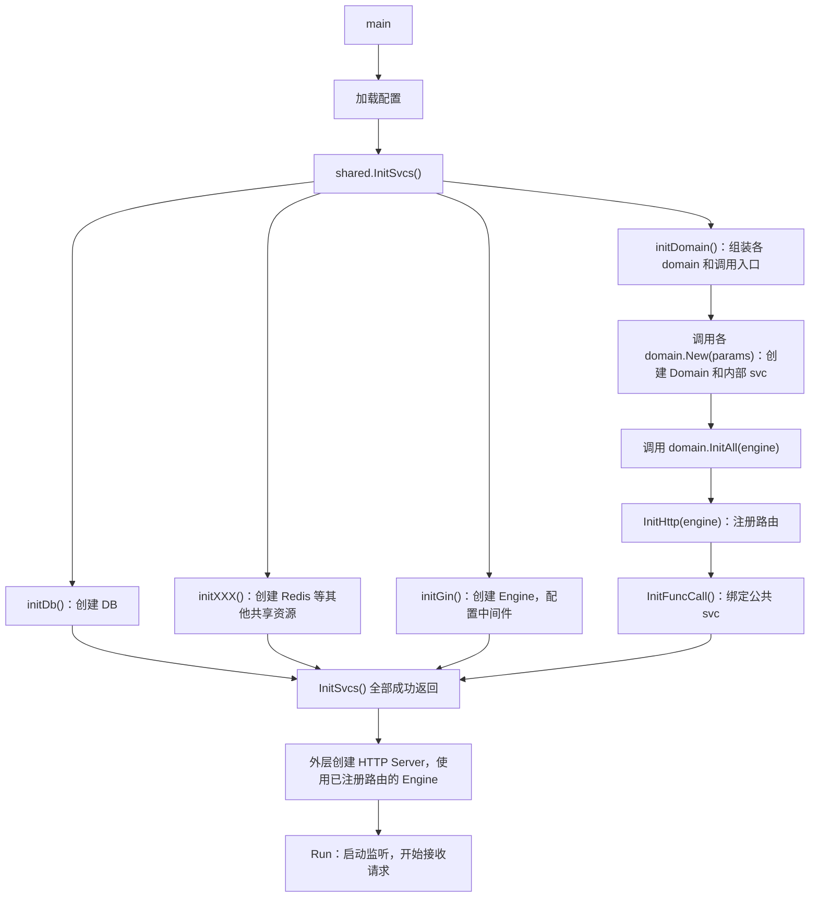

# Go 开发规范

## 技术栈

技术选型统一遵循下表约定，依赖均使用官方 Go 模块路径：

技术栈 | 选用规则
:--- | :---
github.com/gin-gonic/gin | 需要 Web Server 时选用
gorm.io/gorm | 需要数据库时选用
github.com/KevinZonda/GoX | 总是选用
github.com/sirupsen/logrus | 总是选用
github.com/egoist/mygo | 开发 GUI 或桌面应用时选用
github.com/joho/godotenv | 使用 `.env` 文件时选用
github.com/air-verse/air | 需要热重载时选用
github.com/gin-contrib/cors | 需要 CORS 支持时选用
github.com/golang-jwt/jwt/v5 | 使用 JWT 时选用
github.com/ulule/limiter/v3 | 需要 Gin 限流时选用
github.com/getkin/kin-openapi | 需要 OpenAPI 校验时选用

## 目录结构

```txt
cmd/
    -> $cmdName: 各个程序的入口
models/
    -> apimod: API 数据模型
    -> dbmod: 数据库模型
    -> cfg.go 或 cfgmod: 配置模型
shared/ <- 单例或共享实例
    -> 0.go: 初始化入口
    -> cfg.go: 配置初始化
    -> ...
lib/
    -> $libName: 库的适配封装（不含 svc），例如 utils
// 特定场景下的其他目录约定，参见下方三级标题中的说明
```

通常按以下顺序初始化：

```
main()
  -> shared.InitCfg(bytes)
  -> shared.InitSvcs() <- 根据 shared.cfg 初始化服务
    -> shared.initDb()
    -> shared.initXx()
    -> ...
  -> 其他函数调用
```

### 目录结构扩展：Web 服务端

```
domain/
    -> 0.go: 统一的服务注册入口，通常接收 Gin 路由对象，并注册相关服务
             例如：xxxSvc.Register(route); yyySvcRegister(route)
    -> $domainName/
        -> 0.go: 服务初始化入口，通常包含路由注册和依赖注册
        -> dao/: 数据库、文件等资源的原子操作
        -> svc/: 业务逻辑，可组合多个 dao 操作
        -> handler/: HTTP 请求处理，可组合多个 svc 调用
```

domain 表示业务领域，可参考领域驱动设计（DDD）。

> **svc 与 dao 的区别**
>
> dao 只包含数据库原子操作，不绑定具体的数据库实例，实例由参数传入，例如 `func(db, xxxx)`。  
> svc 层可以把多个 dao 操作放在同一个事务中执行，例如 `db.Tx(func(tx) { dao.OperA(tx); dao.OperB(tx) })`。  
> svc 持有它使用的数据库实例，dao 的实例则由调用方传入。

> **分层调用规则**
>
> 以下规则适用于包级函数模式；Scale 模式使用另一套基于实例和 funcCall 的调用规则，见下文。
>
> handler 可以跨 domain 调用 svc，但不能调用 dao 或其他 handler。
> svc 可以跨 domain 调用 dao，但不能调用其他 svc 或 handler。

通常按以下顺序初始化：

```
main()
  -> shared.InitCfg(bytes)
  -> shared.InitSvcs() <- 根据 shared.cfg 初始化服务
    -> shared.initDb()
    -> shared.initXx()
    -> ...
    -> shared.initRoute()
      -> domain.InitRoute(shared.GetGinEngine())
        -> svc1.InitRoute(eng)
        -> svc2.InitRoute(eng)
```

#### 依赖关系




#### 启动顺序



### 目录结构扩展：Scale Web 服务端

业务规模较小时，svc 可以直接写成包级函数（静态函数），所需资源通过包级变量或 shared 获取。业务变复杂之后，如果需要隔离依赖、按不同配置创建多个服务实例，或者方便测试时替换依赖，可以把 svc 改为对象，由实例持有数据库等资源。

每个 domain 负责组装并持有自己的 svc 实例：创建 domain 时通过参数传入所需资源，再由 domain 创建 svc。数据库连接池等共享资源仍由外部统一创建和管理，svc 只保存这些资源的引用。

```txt
domain/
    -> 0.go: 组装各个 domain，传入所需资源，并按需初始化调用入口
    -> $domainName/
        -> 0.go: 定义 Domain、构造参数和 New，创建并持有 svc 实例；可提供 InitAll 组合初始化入口
        -> init_http.go: 可选，注册 HTTP 路由，将本 domain 的 svc 注入 handler
        -> init_func_call.go: 可选，定义 InitFuncCall，调用 funcCall.Init 绑定公共 svc
        -> funcCall/: 对外提供包级业务函数
            -> 0.go: 定义 Init，初始化包级共享状态，绑定供外部调用的 svc
            -> $operation.go: 通过公共 svc 执行业务操作
        -> dao/: 数据库、文件等资源的原子操作，所需资源由调用方传入
        -> svc/: 定义服务对象，持有所需资源，并通过方法实现业务逻辑
        -> handler/: 定义 HTTP 请求处理对象，调用本 domain 的 svc 或 funcCall 包级函数
```

#### 分层调用与 funcCall

Scale 模式下，每个 domain 可以提供一个 `funcCall` 包，作为进程内调用的公开业务入口。`funcCall` 对外全部是包级函数（静态函数）；这些函数需要使用 svc 时，通过 `funcCall/0.go` 中的 `Init(...) error` 绑定一个公共 svc，供包内所有函数共享使用。

```txt
handler
  -> 本 domain 的 svc
  -> funcCall 包级业务函数

svc
  -> 本 domain 的 dao
  -> 本 domain 的其他 svc
  -> 其他 domain 的 funcCall 包级业务函数

funcCall 包级业务函数
  -> 通过 Init 绑定的本 domain 公共 svc
```



订单侧导入库存的 `funcCall` 包，直接调用它的公开函数；库存 funcCall 内部再使用已初始化的公共 svc。调用方不需要持有库存 svc，也不需要注入接口对象。dao 所需的 DB 或事务由本 domain 的 svc 传入，图中省略了这部分资源连线。

handler 负责请求解析、业务调用和响应处理，不调用 dao 或其他 handler。svc 可以组合本 domain 的其他 svc，也可以通过其他 domain 的 funcCall 编排跨领域业务；业务步骤、条件判断和失败处理放在 svc 中。dao 只在所属 domain 内使用。

`funcCall` 包可以依赖本 domain 的 svc，但不导入 domain 根包，也不直接调用 dao。domain 根包负责创建 svc，并可通过 `InitFuncCall() error` 调用 `funcCall.Init(d.svc)`，将已有实例绑定为该包的公共 svc。

funcCall 的公开函数应表达业务能力，不直接返回内部 svc、dao 或数据库连接。调用方通过包级函数使用其他 domain 的能力，不直接访问对方的内部实现。

同 domain 的 svc 之间应保持单向依赖，跨 domain 的 funcCall 调用也应保持单向，避免形成循环导入。公共 svc 在启动阶段显式绑定，业务调用开始后不再替换。每个 funcCall 包只绑定一套 svc，同一套包级函数无法同时对应多个 domain 实例。

#### 初始化与依赖组装

创建实例并注册入口的流程示意（以可能失败的构造函数为例，展示成功路径）：

```txt
d, err := domain1.New(params)
  -> svc := &domain1Svc.Service{DB: params.DB, Z: params.Z}
  -> d := &Domain{svc: svc}
  -> 返回 d, nil

err = d.InitHttp(route) // 按需注册 HTTP 入口
  -> 创建 handler，注入 d 持有的 svc
  -> 注册路由
  -> 返回 error，成功时为 nil

err = d.InitFuncCall()  // 按需初始化进程内函数调用入口
  -> 调用 funcCall.Init(d.svc)，绑定已有公共 svc
  -> 返回 error，成功时为 nil
```

同时需要 HTTP 和 funcCall 入口时，可以提供 `InitAll(engine) error`，依次调用 `InitHttp(engine)` 和 `InitFuncCall()`。

```go
func (d *Domain) InitAll(engine *gin.Engine) error {
    if err := d.InitHttp(engine); err != nil {
        return err
    }
    return d.InitFuncCall()
}
```

下图以使用 `InitAll` 同时初始化两种入口为例：



需要调用的 funcCall 包，都应在业务调用开始前完成 `Init`。创建 domain、注册 HTTP 路由、绑定公共 svc 等阶段，不要调用尚未就绪的其他 domain 业务入口。`InitHttp` 只注册路由，因此可以先于 `InitFuncCall` 执行；等所有需要的入口都初始化成功，才启动请求处理或后台任务。任一步创建或初始化失败时，由外层停止启动，并按资源归属清理已创建的资源。

这些初始化方法都返回 `error`，只复用已有 svc，不重复创建数据库连接或业务实例，也不启动 HTTP 监听；各自的职责划分见下文「生命周期方法命名」。是否提供某个入口取决于场景：仅提供 HTTP 服务时，可以不提供 `InitFuncCall` 和 `InitAll`。

例如，库存 `funcCall/0.go` 绑定公共 svc，包内的业务函数直接使用该实例（省略 import，`svc` 为本 domain 的 svc 包）：

```go
var sharedSvc *svc.Service

func Init(s *svc.Service) error {
    if s == nil {
        return errors.New("inventory funcCall: svc is nil")
    }
    sharedSvc = s
    return nil
}

func DeductStock(productID string, quantity int) error {
    return sharedSvc.DeductStock(productID, quantity)
}
```

domain 根包的 `InitFuncCall` 方法只负责转交已有 svc，`inventoryFuncCall` 为本 domain 的 funcCall 包别名：

```go
func (d *Domain) InitFuncCall() error {
    return inventoryFuncCall.Init(d.svc)
}
```

外层初始化代码创建 domain 后，显式初始化包级入口（省略其他 domain 的同类步骤）：

```go
inventoryDomain, err := inventory.New(inventoryParams)
if err != nil {
    return err
}

orderDomain, err := order.New(orderParams)
if err != nil {
    return err
}

if err := inventoryDomain.InitFuncCall(); err != nil {
    return err
}

if err := orderDomain.InitHttp(route); err != nil {
    return err
}
```

handler 调用订单 svc，订单 svc 直接调用 `inventoryFuncCall.DeductStock(productID, quantity)`；库存 funcCall 使用 `Init` 已绑定的公共 svc 执行业务。

funcCall 只保存公共 svc 的引用，不负责关闭它；连接池等资源的归属和释放规则见下文「资源归属与释放」。

这种结构主要用于隔离依赖和管理实例。是否采用，要看业务复杂度和依赖管理需求，不必仅仅因为请求量增加就把所有 svc 改为对象。

## 初始化与生命周期约定

### 0.go 与初始化顺序

`0.go` 是团队约定的初始化入口文件名，可以继续使用，无需统一改成 `init.go`。文件名只用于组织代码，不要依赖文件名来决定初始化顺序。

`New`、`Init` 都是普通函数，不会因为放在 `0.go` 里就自动执行，和 Go 自动调用的 `init()` 不是一回事。资源和业务实例之间有初始化依赖时，外层组件应按依赖顺序显式调用。

### New 与 Init 的语义

`New` 创建并返回新实例；`Init` 初始化已有实例或包级状态，不返回实例。签名按以下约定选择：

```txt
xxx.New(params)      -> instance           // 构造过程不会失败
xxx.New(params)      -> (instance, error)  // 构造过程可能失败
instance.Init(params) -> error            // 初始化已有实例
xxx.Init(params)     -> error             // 初始化包级状态
```

`New` 应完成实例可用所需的初始化，通常调用方无需再执行一次 `Init`；只有需要分阶段初始化时，才额外提供 `Init`，并说明调用时机和前置条件。

`Init`、`InitHttp`、`InitFuncCall`、`InitAll` 等初始化方法统一返回 `error`，成功时返回 `nil`。例如，`funcCall.Init(svc)` 初始化包级共享状态，不创建并返回 svc。获取已有对象或资源的方法按其业务含义命名，不使用 `Init` 前缀。

### 生命周期方法命名

初始化实例、注册调用入口和启动服务是三件不同的事，方法名应区分开，按以下职责命名：

方法 | 职责
:--- | :---
`New` | 创建并返回实例，接收并组装依赖；可能失败时同时返回 error
`Init` | 初始化已有实例或包级状态，返回 error，不返回实例
`InitHttp` | 注册 HTTP 路由、注入 handler 依赖，返回 error，不启动监听
`InitFuncCall` | 调用 funcCall 包的 Init，绑定已有公共 svc，返回 error
`InitAll` | 依次调用 InitHttp 和 InitFuncCall，遇到错误立即返回，不启动服务
`Run` | 启动服务，例如监听端口或运行后台任务
`Close` | 释放组件自身拥有的资源
`Shutdown(ctx)` | 在需要优雅停机时，停止接收新工作，等待在途工作结束，并按资源归属完成清理

按实际职责提供这些方法，无需为每个组件实现全部方法。`Close` 和 `Shutdown` 也不要求同时存在；如果同时提供，应明确两者的关系，避免重复释放资源。

### 资源归属与释放

资源的生命周期由创建它的组件负责管理。把资源注入 domain 或 svc，只是传递使用权，并不转移关闭责任；Scale 模式下尤其要明确这一点。

- 共享 DB、Redis 连接池由创建它们的外层组件统一关闭，domain 和 svc 不得自行关闭注入的共享连接池。
- domain 内部创建并独占的资源，由该 domain 的 `Close()` 或 `Shutdown(ctx)` 释放；如果只有注入的资源引用，可以不提供关闭方法。
- HTTP Server 由创建并启动它的服务端组件负责关闭，domain 的 `InitHttp` 只注册路由。

退出时按依赖关系安排清理顺序：先停止接收新请求和任务，等待在途请求和后台任务结束，再释放 domain 自有资源，最后由外层组件关闭共享 DB、Redis 等资源。如果等待超时，后续处理由外层停机逻辑统一决定，避免仍在运行的任务继续使用已关闭的资源。

## 缩写约定

缩写 | 英文全称 | 中文含义
:--- | :--- | :---
svc | service | 服务
svr | server | 服务端
clt | client | 客户端
cli | command line interface | 命令行界面
cfg | config | 配置
rcv/recv | receive | 接收
req | request | 请求
resp | response | 响应
gen | generate | 生成
oper | operator | 操作或运算符
neg | negative | 负值或否定
pub | public | 公开的
priv | private | 私有的
fk | foreign key | 外键
pk | public key / primary key | 公钥或主键
sk | secret key / private key | 密钥或私钥
pubk | public key | 公钥
seck, privk  | secret key / private key | 密钥或私钥
sec | secret | 秘密
ptr | pointer | 指针
fx/func | function | 函数
incr/inc | increase | 增加
dec | decode / decrease | 解码或减少
plt | plot | 绘图
opt | option | 选项
unk | unknown | 未知
mk | make | 创建
